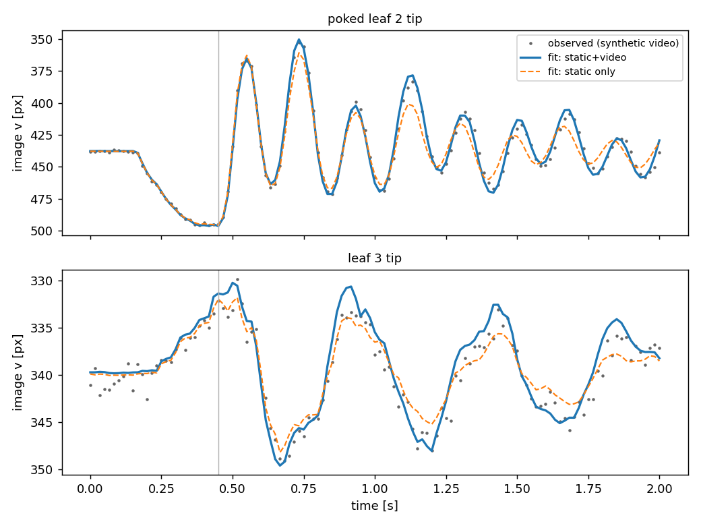

# Heliades

A simulation-first, GPU-native successor to [Helios](https://github.com/PlantSimulationLab/Helios) for
generating simulation-ready crop assets. It is built on Python, NVIDIA Warp and OpenUSD.
In Greek myth the Heliades, daughters of Helios, turned into poplar trees.

The repository has two parts:
- **`heliades/`**: Helios's functionality moved to the new platform, verified by differential tests
  against a pinned Helios build. See [Heliades](#heliades-helios-on-a-new-platform-heliades-lgpl-21-or-later) below.
- **`planttwin/`**: the deformable plant simulator (Cosserat rods + XPBD leaves), the Helios → sim-asset
  converter, and the Real2Sim experiments.

License: LGPL-2.1-or-later (derivative of Helios; see `NOTICE.md`).

---

## PlantTwin: casual smartphone captures → simulation-ready deformable plants

```
phone multi-view photos ──► 3D recon (COLMAP + 3DGS / GaussianPlant)  ─┐   [TODO: front end]
                                                                       ▼
                         Structured PlantAsset  (stem graph + radii + leaf meshes + attachments)
                                                                       │   planttwin/asset.py
                                                                       ▼
                         Deformable sim: Cosserat-rod stem + XPBD leaf shells + contact
                                                                       │   planttwin/sim.py
phone poke video ──► 2D keypoint tracks ──►  Real2Sim: fit E_stem, leaf stiffness, damping
                     (CoTracker / TAPIR)                                   planttwin/real2sim.py
```

This repo currently builds the **back half** of that pipeline end to end on a procedural
plant (`planttwin/procedural.py` stands in for reconstruction), so the most important
research risk — *can physical parameters be identified from a phone video at all?* — is
tested before any reconstruction work is done.

## Layout

| file | what |
|---|---|
| `planttwin/asset.py` | `PlantAsset` = `StemGraph` (nodes, parent→child edges, radius, fixed) + `Leaf` meshes (welded to a stem node, tracked keypoints) + `PhysicsParams`. JSON round-trip. The contract between recon and sim. |
| `planttwin/helios_import.py` | Helios (PyHelios) plant → PlantAsset converter, ~30 crop species. |
| `planttwin/procedural.py` | Synthetic potted plant: stem, phyllotactic petioles, elliptic leaf meshes. |
| `planttwin/sim.py` | Small-step XPBD, graph-coloured Gauss–Seidel, **batched over parameter sets**. Stem = Cosserat rod (per-segment quaternions; bend/twist compliance = l/(E·I), l/(G·J) from the per-node radius). Leaves = distance + bending on the mesh; leaf base rigidly attached to the petiole-tip frame (two-way). Kinematic sphere colliders + ground. |
| `planttwin/camera.py` | Pinhole `Camera.look_at`, `project` (the Π in the loss). |
| `planttwin/real2sim.py` | `PokeExperiment` (finger presses a leaf, lifts off), synthetic observations, batched multi-process loss, differential-evolution fit in log-parameter space. |
| `scripts/real2sim_demo.py` | Identifiability experiment: static-photo-only vs static+poke-video. |
| `scripts/helios_gallery.py` | Convert 8 crops, save assets + gallery figure. |
| `scripts/render_poke.py` | Snapshot figure of rest / equilibrium / pressed / released. |
| `tests/` | quaternion helpers, JSON round-trip, equilibrium is static, stiffness monotonicity, batch == single, contact, camera. |

```bash
pip install -e .[dev]
pytest -q                                            # ~1 min
OMP_NUM_THREADS=1 python scripts/render_poke.py      # outputs/poke_frames.png
OMP_NUM_THREADS=1 python scripts/real2sim_demo.py    # ~20 min on 16 cores; --quick for a smoke test
```

## Results so far (synthetic)

`scripts/real2sim_demo.py`, seed 0, 1 px track noise, 10 tracked points (leaf tips + mids),
differential evolution with 10 generations × 24 members (352 rollouts):

| param | true | static photo only | static + 2 s poke video |
|---|---|---|---|
| stem E [Pa] | 1.0e8 | 1.005e8 (+0.5%) | 1.029e8 (+2.9%) |
| leaf bend compliance | 0.020 | 0.0193 (−3.7%) | 0.0188 (−6.0%) |
| damping [1/s] | 1.2 | 1.87 (+56%, unidentifiable) | 0.96 (−20%) |
| final loss [px²] | noise ≈ 2 | 1.49 | 4.84 (not converged) |



How to read this:
- **Static stiffness looks identifiable only because the rest shape is known here.**
  With known rest shape and density, the sag pins down stiffness. On real data the rest
  shape is unknown (item 6 below), and stiffness and rest shape trade off. So this
  number is optimistic, and the next experiment is to repeat it with inverse statics in the loop.
- **Damping needs the video** (as expected). The video fit hasn't converged: loss 4.8 vs a
  noise floor of ~2, and the damping estimate was still moving between generations. It needs
  more generations or a local polish (e.g. Nelder–Mead from the DE optimum).

## Phase 1: crop assets from Helios (`planttwin/helios_import.py`)

Current focus: asset generation + simulator (Real2Sim parked). [Helios](https://github.com/PlantSimulationLab/Helios)
(LGPL-2.1; Python bindings `pip install pyhelios3d`, MIT) grows ~30 species procedurally.
`build_helios_plant(species, age, seed)` converts one into a `PlantAsset`:
shoots/petioles/peduncles → one rooted rod graph with radii; leaflet bases inserted as
rachis nodes (snapped to ≥5 mm segments); leaflet render meshes (~144 tris) → ~20-vertex
sim meshes by clustering in texture-UV space (robust to arching maize leaves), base fanned
to the first row; fruit → pedicel node carrying the lumped mass.

`scripts/helios_gallery.py` → `outputs/helios/gallery.png`, `summary.json`:

| crop | age | height | rod nodes | leaflets kept | fruit | sim particles | convert |
|---|---|---|---|---|---|---|---|
| tomato | 75 d | 0.76 m | 129 | 112/112 | 6 (66 g) | 2257 | 0.6 s |
| cherrytomato | 75 d | 1.05 m | 170 | 180/180 | 0 | 3602 | 0.8 s |
| capsicum | 80 d | 0.88 m | 35 | 29/29 | 0 | 673 | 0.1 s |
| strawberry | 60 d | 0.34 m | 125 | 45/45 | 2 (22 g) | 845 | 0.2 s |
| bean | 45 d | 0.50 m | 583 | 263/263 | 0 | 4876 | 1.4 s |
| soybean | 50 d | 0.78 m | 509 | 170/170 | 0 | 3059 | 0.8 s |
| grapevine_VSP | 120 d | 1.91 m | 2088 | 885/885 | 32 clusters | 16248 | 8.6 s |
| maize | 50 d | 1.46 m | 38 | 17/17 | 1 | 973 | 0.6 s |

**Simulation status: the converted crops do not yet hold their shape.** Full-size crops
creep/collapse under gravity in the current solver, even with steel-like E = 1e11 Pa
(tomato stem top still moving 3–8 cm/s after 1.5 s at 256 substeps). Causes found:
1. *Iterative XPBD can't converge long, thin, stiff rod chains carrying heavy distal loads*
   (leaves + 11 g fruit on near-massless pedicels). Residuals shrink with substeps but too
   slowly. Plants are trees, so a direct linear-time tree solver for the rods (Deul et al.
   2018-style) or reduced coordinates is the natural fix, and it's a plant-specific simulator contribution.
2. *Leaf stiffness is not physical*. The effective leaf compliance was tuned on 7 cm leaves,
   so 80 cm maize blades and big strawberry leaves hang straight down. Needs a midrib rod
   plus a lamina shell with thickness-based stiffness.
3. *Helios shapes already include kinematic gravity droop*, so settling double-counts
   gravity. Needs inverse statics to recover an unloaded rest shape.
4. Two bugs fixed on the way: tiny segments next to heavy leaflet pairs (creep), and a leaf
   base hinged on a single triangle edge (flopping).

Also note: Helios itself now exports **articulated rigid-body USD for Isaac Sim**
(`writePlantStructureUSD`: capsule links, E·I/L joint springs, leaves/fruit as spring-attached
masses, armature for stability) and a static cantilever petiole bend
(`bendPetioleUnderLeafWeight`). That is the baseline to beat: leaves there are rigid
masses, not deformable. Helios's `seedRandomGenerator` didn't change the tomato build
between seeds 0 and 1, so variation needs parameter sampling, not just seeds.

### Videos (`scripts/make_videos.py` → `outputs/videos/`)

- `growth_tomato.mp4`: Helios tomato growing from day 10 to day 80 (render meshes, orbiting camera).
- `poke_procedural.mp4`: procedural plant pressed by a finger, released, ringing down (stable case).
- `settle_helios_tomato.mp4`: Helios tomato in the current XPBD sim, collapsing (the solver problem above).

`.venv/bin/python scripts/make_videos.py [growth poke settle]`, ~40 s each (matplotlib frames → ffmpeg).

## Heliades: Helios on a new platform (`heliades/`, LGPL-2.1-or-later)

Helios's functionality is being moved to a Python + NVIDIA Warp + OpenUSD platform, and dynamics,
batching and agent-authored species are added on top. The port is driven by **differential testing
against a pinned Helios build**:

- **Baseline:** Helios 1.3.98 (`14860044f`). The oracle is PyHelios built from that tree in
  `third_party/pyhelios_src`.
- **Workflow:** porting rules and per-module steps are in `migration/PORTING.md`.
- **Coverage:** `migration/STATUS.md`, generated by `migration/inventory.py` (2363 public API symbols).
- **Discrepancies found so far:** `migration/HELIOS_ISSUES.md`.

| piece | file |
|---|---|
| Bit-exact Helios RNG (minstd_rand0 + portable distributions) | `heliades/core/random.py` |
| Scene/primitive geometry, float32 op-for-op with `Context_primitive.cpp` | `heliades/core/scene.py` |
| Compound objects: tube (parallel-transport frames), tile, polymesh; 0-ulp vs Helios | `heliades/core/scene.py`, `heliades/core/vec.py` |
| Demo: toy plant from tubes + tiles, USD + PNG, parity-checked | `scripts/heliades_demo.py` → `outputs/heliades/` |
| GPU BVH + batched ray casting (Warp) | `heliades/core/device.py` |
| USD export (UUIDs and primitive data as primvars) | `heliades/io/usd.py` |
| Parity harness: one case runs on both backends; exact / ulp / dist tiers | `heliades/parity/` |

```bash
python -m heliades.parity            # all parity cases vs Helios
python migration/inventory.py          # coverage report
pytest -q tests/heliades
```

## Things learned building this (that matter for the research plan)

1. **The stem must be a rod with orientation, not a particle chain.** A position-only
   bending constraint on a *curved* rest shape has a zero-energy mode: the curve can rotate
   about its chord (no twist stiffness), and the plant slowly collapses (~20 cm drift with
   no external force). Reconstructed petioles are always curved, so this is not a corner
   case. Fixed with Cosserat segments; `test_equilibrium_is_static` guards it.
2. **Parameterise by physics, not by solver knobs.** Joint compliance = l/(E·I) with
   I = πr⁴/4 from the reconstructed radius: one Young's modulus explains the whole tree,
   and the fitted number is comparable to biomechanics literature. Radius estimation in
   reconstruction therefore matters a lot (stiffness ∝ r⁴).
3. **XPBD has a numerical stiffness floor.** Residuals scale with h²: tip sag at default
   params is roughly 60 / 26 / 12 mm at 16 / 32 / 64 substeps. All fits here use 64
   substeps and are self-consistent, but an absolute E from real data needs either far
   more substeps (GPU: Warp/Newton) or a direct solver for rods (Deul et al. 2018).
4. **Batching is the cheap speed-up.** numpy cost is per-op overhead, so simulating 48
   parameter sets in lock-step costs ~4× one set. Population optimisers (DE/CMA-ES) map
   onto this directly; a GPU port should keep the same "batch = population" design.
5. **Mass vs stiffness is not identifiable from video.** With gravity and a
   position-controlled finger, scaling all masses and stiffnesses by the same factor gives
   identical motion. Densities are held at priors; absolute stiffness needs a known force
   (e.g. a hanging weight of known mass, or a force-sensing robot finger).
6. **The photo shows the *loaded* shape.** Reconstruction gives the gravity equilibrium,
   but the sim needs the unloaded rest shape. Here the rest shape is known (synthetic);
   on real data an inverse-statics step (find rest shape s.t. settle(rest) = photo) is
   required, and it depends on the stiffness being fitted.

## Next steps

- [ ] Inverse statics inside the fit loop (rest shape from the photographed equilibrium).
- [ ] Real data path: COLMAP poses + metric scale (reference object) → GaussianPlant /
      LeafFit-style structure → `PlantAsset`; CoTracker tracks on a poke video → `Observation`.
- [ ] Port `sim.py` to Warp (or Newton) keeping batch-over-parameters; raise substeps.
- [ ] Physical leaf plate stiffness (E·t³) instead of an effective compliance.
- [ ] Unknown poke force: track the finger in the video and use it as the kinematic collider.
- [ ] Robot interaction: replace the sphere with a gripper; Real2Sim2Real manipulation.
